 

 

---

### 🛰️ Transmission

Développeur fullstack, je conçois des sites et des applications web, du front soigné à l'API.
Je travaille en freelance et je suis toujours partant pour une nouvelle mission.

### 🪐 Système stellaire

### 🚀 Missions récentes

| Mission | Carburant |
| --- | --- |
| [**Portfolio**](https://github.com/N0amG/Portfolio) : mon site, [noamguez.fr](https://noamguez.fr) | TypeScript · Next.js |
| [**Multiplayer_Pong**](https://github.com/N0amG/Multiplayer_Pong) : Pong multijoueur | TypeScript |
| [**space_invaders**](https://github.com/N0amG/space_invaders) : les envahisseurs de l'espace | Python |

### 🌌 Un serpent dans la Voie lactée

<picture>
  <source media="(prefers-color-scheme: dark)" srcset="https://raw.githubusercontent.com/N0amG/N0amG/output/snake-space-dark.svg"/>
  <source media="(prefers-color-scheme: light)" srcset="https://raw.githubusercontent.com/N0amG/N0amG/output/snake-space-light.svg"/>
  
</picture>

✦ *per aspera ad astra* ✦

