  

### 🛰️ Transmission

Développeur fullstack, je conçois des sites et des applications web, du front soigné à l'API.
Je travaille en freelance et je suis toujours partant pour une nouvelle mission.

### 🪐 Système stellaire

 

 

✦ *per aspera ad astra* ✦

